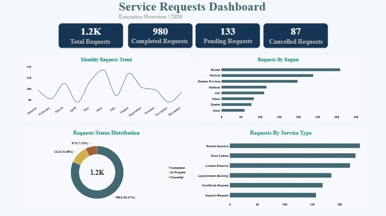
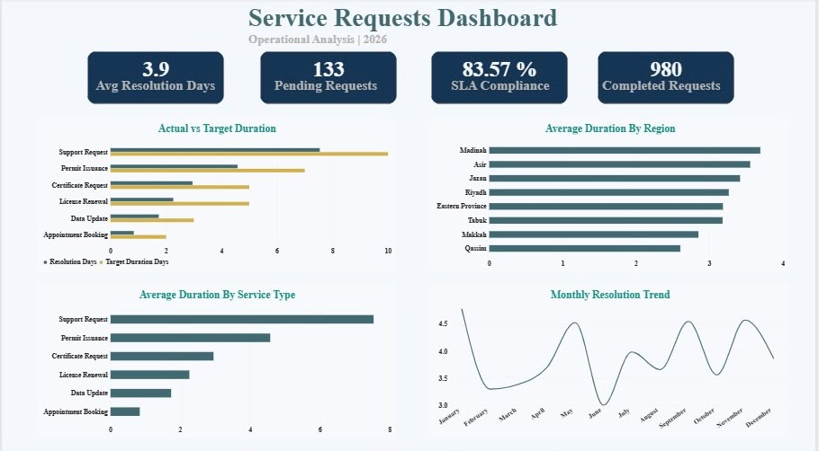

# Service Requests Performance Dashboard

An interactive Power BI dashboard designed to analyze service request performance, monitor operational efficiency, and evaluate SLA compliance.

## Project Overview

This project analyzes service request data to provide insights into request volumes, completion rates, resolution times, and operational performance across regions and service categories.

## Business Problem

Organizations need clear visibility into service operations to monitor performance, identify potential bottlenecks, and evaluate compliance with target resolution times.

This dashboard consolidates key operational metrics into an interactive reporting solution to support data-driven decision-making.

## Key Performance Indicators

| KPI | Result |
|---|---:|
| Total Requests | 1,200 |
| Completed Requests | 980 |
| In-Progress Requests | 133 |
| Cancelled Requests | 87 |
| Completion Rate | 81.67% |
| SLA Compliance Rate | 83.57% |
| Average Resolution Time | 3.9 Days |
| Completed Requests Exceeding Target | 161 |

## Dashboard Pages

### 1. Executive Overview
- Executive KPI Summary
- Monthly Requests Trend
- Request Status Distribution
- Regional Performance Analysis
- Service Category Analysis

### 2. Operational Analysis
- Average Resolution Time by Region
- Average Resolution Time by Service Type
- Actual vs. Target Resolution Duration
- Monthly Resolution Trend
- SLA Performance Monitoring

## Data Preparation & Analysis

- Data cleaning and transformation using Power Query.
- Data quality validation and missing value handling.
- KPI development using DAX.
- Analysis of request statuses and service performance.
- Evaluation of average resolution time and SLA compliance.

## Tools & Skills

Power BI | Power Query | DAX | Data Cleaning | Data Analysis | Data Visualization | KPI Development | Business Intelligence

## Business Value

The dashboard provides a consolidated view of service performance, helping stakeholders monitor operational efficiency, identify potential bottlenecks, and evaluate compliance with target service levels.

---

**Project Type:** Data Analytics Portfolio Project  
**Tool:** Microsoft Power BI
## Dashboard Preview

### Executive Overview

### Operational Analysis

## Project Documentation

[View Project Documentation (PDF)](Service%20Requests%20Performance%20Dashboard.pdf)
